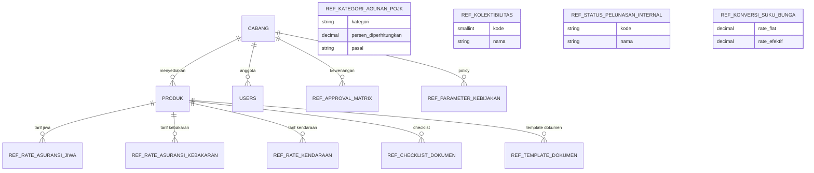
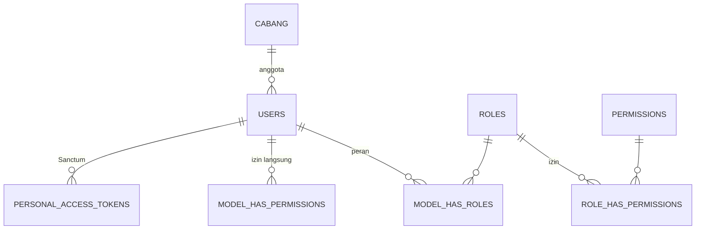
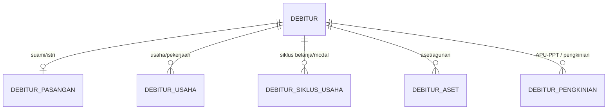
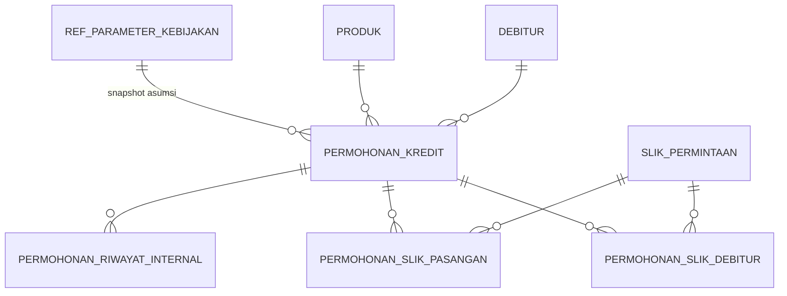
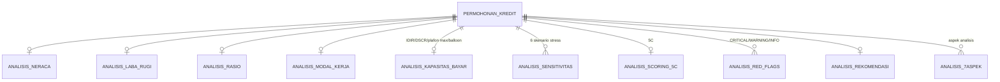
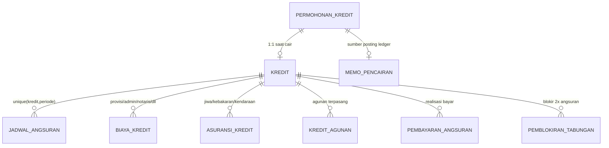
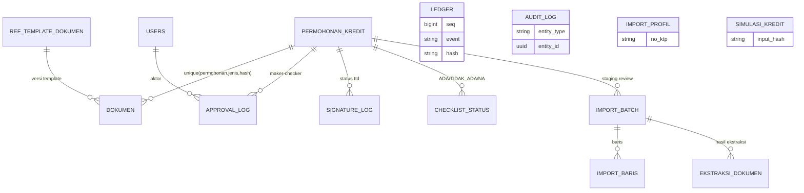
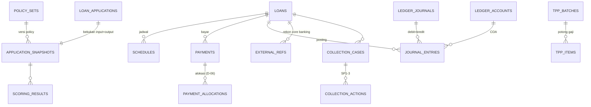

# ERD — Aplikasi Analisis Kredit, Dokumen & Ledger BPR

**Produk:** Loan Analytic BPR (PT BPR Bahteramas Kendari)  
**Versi dokumen:** 0.1 (DRAFT, living) · **Tanggal:** 2026-11-05 (WITA)  
**Label bukti:** `[E]` terverifikasi dari migrasi/model repo app · `[A]` usulan/desain · `[K]` perlu verifikasi/keputusan · `[Rencana]` belum terimplementasi.

> Diagram memakai **nama tabel yang benar-benar ada** di repo app (`database/migrations`, 61 migrasi · 55 model · 35 enum) `[E]`. Entitas target yang belum ada ditandai `[Rencana]` (§8).

## 1. Konvensi skema `[E]`
| Aspek | Konvensi |
|---|---|
| Primary key | `uuid` (kecuali `users`, Spatie `permissions/roles`, `ledger.seq`, `jadwal_angsuran.id` = auto-increment) |
| Multi-tenant/cabang | `cabang_id` FK hampir di semua tabel domain (`restrictOnDelete`) |
| Uang | `decimal(15,2)` (rupiah) — **catatan gap:** rencana menargetkan `BIGINT` + `brick/math` `[K]` (§9) |
| Rasio/skor | `decimal(10,4)`; rate/suku bunga `decimal(5,4)` (0–1) |
| JSON | `jsonb` (payload ledger, snapshot) |
| Enum | kolom string + `CHECK` via `App\Support\Database\CheckConstraint` |
| Soft delete | `deleted_at` pada tabel master/domain tertentu |
| Immutability | trigger PostgreSQL pada `ledger` & `audit_log` (BR-09) |
| Index parsial | untuk status aktif (mis. `kredit_active_idx WHERE status='ACTIVE'`) |

## 2. Peta domain → tabel `[E]`
| Domain | Tabel |
|---|---|
| Master/Referensi | `cabang`, `produk`, `ref_kategori_agunan_pojk`, `ref_kolektibilitas`, `ref_status_pelunasan_internal`, `ref_rate_asuransi_jiwa`, `ref_rate_asuransi_kebakaran`, `ref_rate_kendaraan`, `ref_konversi_suku_bunga`, `ref_checklist_dokumen`, `ref_parameter_kebijakan`, `ref_approval_matrix`, `ref_template_dokumen` |
| Auth/RBAC | `users`, `permissions`, `roles`, `model_has_roles`, `model_has_permissions`, `role_has_permissions`, `personal_access_tokens` (Sanctum), `cache`, `jobs` |
| Debitur | `debitur`, `debitur_pasangan`, `debitur_usaha`, `debitur_siklus_usaha`, `debitur_aset`, `debitur_pengkinian` |
| Permohonan & SLIK | `permohonan_kredit`, `slik_permintaan`, `permohonan_slik_debitur`, `permohonan_slik_pasangan`, `permohonan_riwayat_internal` |
| Analisis | `analisis_neraca`, `analisis_laba_rugi`, `analisis_rasio`, `analisis_modal_kerja`, `analisis_kapasitas_bayar`, `analisis_sensitivitas`, `analisis_scoring_5c`, `analisis_red_flags`, `analisis_rekomendasi`, `analisis_7aspek` |
| Kredit & turunan | `kredit`, `jadwal_angsuran`, `biaya_kredit`, `asuransi_kredit`, `kredit_agunan`, `memo_pencairan`, `pemblokiran_tabungan`, `pembayaran_angsuran` |
| Dokumen & workflow | `dokumen`, `approval_log`, `signature_log`, `checklist_status`, `notifikasi` |
| Ledger/audit/import/simulasi | `ledger`, `audit_log`, `import_profil`, `import_batch`, `import_baris`, `ekstraksi_dokumen`, `simulasi_kredit` |

## 3. ERD inti (alur end-to-end)

```mermaid
erDiagram
    CABANG            ||--o{ USERS                 : "menaungi"
    CABANG            ||--o{ DEBITUR               : "menaungi"
    CABANG            ||--o{ PERMOHONAN_KREDIT     : "menaungi"
    PRODUK            ||--o{ PERMOHONAN_KREDIT     : "jenis produk"
    USERS             ||--o{ PERMOHONAN_KREDIT     : "AO"

    DEBITUR           ||--o| DEBITUR_PASANGAN      : "pasangan"
    DEBITUR           ||--o{ DEBITUR_USAHA         : "usaha"
    DEBITUR           ||--o{ DEBITUR_SIKLUS_USAHA  : "siklus"
    DEBITUR           ||--o{ DEBITUR_ASET          : "aset"
    DEBITUR           ||--o{ DEBITUR_PENGKINIAN    : "pengkinian"
    DEBITUR           ||--o{ PERMOHONAN_KREDIT     : "mengajukan"

    PERMOHONAN_KREDIT ||--o{ PERMOHONAN_SLIK_DEBITUR   : "fasilitas SLIK"
    PERMOHONAN_KREDIT ||--o{ PERMOHONAN_SLIK_PASANGAN  : "fasilitas SLIK pasangan"
    PERMOHONAN_KREDIT ||--o{ PERMOHONAN_RIWAYAT_INTERNAL : "riwayat internal"
    SLIK_PERMINTAAN   ||--o{ PERMOHONAN_SLIK_DEBITUR   : "hasil tarikan"
    SLIK_PERMINTAAN   ||--o{ PERMOHONAN_SLIK_PASANGAN  : "hasil tarikan"
    REF_KOLEKTIBILITAS ||--o{ PERMOHONAN_SLIK_DEBITUR  : "kolek"
    REF_KOLEKTIBILITAS ||--o{ PERMOHONAN_SLIK_PASANGAN : "kolek"

    PERMOHONAN_KREDIT ||--o| ANALISIS_NERACA          : "1:1"
    PERMOHONAN_KREDIT ||--o| ANALISIS_LABA_RUGI       : "1:1"
    PERMOHONAN_KREDIT ||--o| ANALISIS_RASIO           : "1:1"
    PERMOHONAN_KREDIT ||--o| ANALISIS_MODAL_KERJA     : "1:1"
    PERMOHONAN_KREDIT ||--o| ANALISIS_KAPASITAS_BAYAR : "1:1"
    PERMOHONAN_KREDIT ||--o| ANALISIS_SCORING_5C      : "1:1"
    PERMOHONAN_KREDIT ||--o| ANALISIS_REKOMENDASI     : "1:1"
    PERMOHONAN_KREDIT ||--o{ ANALISIS_SENSITIVITAS    : "1:n"
    PERMOHONAN_KREDIT ||--o{ ANALISIS_RED_FLAGS       : "1:n"
    PERMOHONAN_KREDIT ||--o{ ANALISIS_7ASPEK          : "1:n"
    REF_PARAMETER_KEBIJAKAN ||--o{ ANALISIS_KAPASITAS_BAYAR : "snapshot policy"

    PERMOHONAN_KREDIT ||--o{ DOKUMEN           : "dokumen"
    PERMOHONAN_KREDIT ||--o{ APPROVAL_LOG      : "approval"
    PERMOHONAN_KREDIT ||--o{ SIGNATURE_LOG     : "tanda tangan"
    PERMOHONAN_KREDIT ||--o{ CHECKLIST_STATUS  : "checklist"
    PERMOHONAN_KREDIT ||--o| MEMO_PENCAIRAN    : "memo cair"

    PERMOHONAN_KREDIT ||--o| KREDIT            : "cair menjadi"
    KREDIT            ||--o{ JADWAL_ANGSURAN   : "jadwal"
    KREDIT            ||--o{ BIAYA_KREDIT      : "biaya"
    KREDIT            ||--o{ ASURANSI_KREDIT   : "asuransi"
    KREDIT            ||--o{ KREDIT_AGUNAN     : "agunan"
    KREDIT            ||--o{ PEMBAYARAN_ANGSURAN : "pembayaran"
    KREDIT            ||--o{ PEMBLOKIRAN_TABUNGAN : "blokir tabungan"
```

## 4. ERD per domain

### 4.1 Master & referensi

### 4.2 Auth/RBAC

### 4.3 Debitur

### 4.4 Permohonan & SLIK

### 4.5 Analisis

### 4.6 Kredit & turunan

### 4.7 Dokumen, workflow & ledger

## 5. Kolom kunci & invariant `[E]`
| Tabel | Kolom kunci | Constraint/invariant |
|---|---|---|
| `debitur` | `no_ktp char(16)`, `nama_ktp`, `cabang_id` | unique `no_ktp` (aktif); CHECK gender/perkawinan/sumber; `jumlah_* >= 0` |
| `permohonan_kredit` | `no_permohonan` (unik), `plafon_diajukan`, `suku_bunga_tahunan`, `tenor_diajukan`, `sistem_suku_bunga`, `sumber_pelunasan_balloon` | CHECK **balloon wajib bila Gracia**; plafon>0 & rekomendasi≤diajukan; rate 0<r≤0,5; tenor 1–360; index `cabang_id,status,tanggal DESC` |
| `permohonan_slik_debitur` | `permohonan_id`, `urutan`, `plafon`, `baki_debet`, `kolektibilitas_id` | unique (`permohonan_id`,`urutan`); nilai ≥0; rate 0–1 |
| `analisis_kapasitas_bayar` | `permohonan_id` (unik), `rpc_bulanan`, `dscr_*`, `plafon_max_flat/anuitas/grace`, `idir`, `rasio_kecukupan_balloon` | 1:1 permohonan; `parameter_kebijakan_id` (snapshot policy) |
| `kredit` | `no_rekening_kredit` (unik), `plafon`, `rate`, `tenor`, `angsuran_bulanan`, `status` | plafon>0; rate 0<r≤1; tenor 1–360; index parsial `status='ACTIVE'` |
| `jadwal_angsuran` | `kredit_id`, `periode`, `saldo_awal`, `angsuran_pokok`, `bunga`, `total_angsuran`, `saldo_akhir` | unique (`kredit_id`,`periode`); semua nilai ≥0 |
| `dokumen` | `permohonan_id`, `jenis_dokumen`, `file_hash` | unique (`permohonan`,`jenis`,`file_hash`) |
| `ledger` | `seq`, `event` (enum 23), `entity_type/id`, `idempotency_key` (unik), `payload jsonb`, `prev_hash`/`hash` | **trigger immutable** (BR-09); hash-chain |
| `audit_log` | — | **trigger immutable**; index GIN |
| `import_batch` | `jenis`, `file_hash` | unique (`jenis`,`file_hash`) |
| `simulasi_kredit` | `input_hash`, enum produk/sistem | deterministik; kolom rasio/skor/IP belum diisi `[E → Rencana]` |

## 6. Relasi & kardinalitas (ringkas) `[E]`
- `Debitur` hasMany `permohonan`, `usaha`, `siklusUsaha`, `aset`, `pengkinian`; hasOne `pasangan`.
- `PermohonanKredit` hasMany `slikDebitur`, `slikPasangan`, `sensitivitas`, `redFlags`, `dokumen`, `approvalLog`, `checklist`; hasOne `neraca`, `labaRugi`, `rasio`, `modalKerja`, `kapasitasBayar`, `scoring5c`, `rekomendasi`, `memoPencairan`; belongsTo `debitur`, `produk`, `cabang`, `user (AO)`, `refParameterKebijakan`.
- `Kredit` belongsTo `permohonan`; hasMany `jadwal`, `biaya`, `asuransi`, `agunan`, `pembayaran`, `pemblokiranTabungan`.
- `User` belongsTo `cabang` (implisit); `HasRoles` (Spatie).

## 7. Enum penting `[E]`
| Enum | Nilai |
|---|---|
| `SistemSukuBunga` | `Flat` · `Anuitas` · `Grace Period` |
| `Kolektibilitas` (int) | 1 Lancar · 2 DPK · 3 Kurang Lancar · 4 Diragukan · 5 Macet |
| `ProdukTipe` | `TPP` · `MODAL_KERJA` · `GRACE_PERIOD` |
| `StatusKredit` | `ACTIVE` · `LUNAS` · `NPL` · `CLOSED` |
| `RatingKredit` | `SANGAT LAYAK` · `LAYAK` · `LAYAK BERSYARAT` · `TIDAK LAYAK` |
| `StatusKelayakan` | `LAYAK` · `PERHATIAN` · `TIDAK LAYAK` |
| `LevelRedFlag` | `CRITICAL` · `WARNING` · `INFO` |
| `StatusChecklist` | `ADA` · `TIDAK_ADA` · `NA` · `TIDAK_WAJIB` |
| `LedgerEvent` | 23 nilai (pencairan, biaya, blokir/rilis, angsuran, denda, reversal, …) |
| `StatusPermohonan` | 11 nilai (DRAFT → … → CAIR/LUNAS/DITOLAK) |

## 8. Entitas target `[Rencana]` (belum ada di skema saat ini)
Turunan rencana (`03-rencana-implementasi-detail.md` §5) yang belum terimplementasi dan perlu ditambahkan/dipetakan:
| Kelompok | Entitas target `[A]` | Status vs skema `[E]` |
|---|---|---|
| Master/policy | `tenants`, `policy_sets` (versioned), `fee_rules`, `collateral_categories`, `insurers`+`rate_tables`, `scoring_models/factors/options`, `checklist_templates`, `document_types/letter_templates`, `institutions/treasurers/collective_agreements`, `number_sequences`, `coa_accounts` | sebagian ada sebagai `ref_*`; versioning policy (`policy_sets`) belum `[Rencana]` |
| Parties | `customers`(+`identities` terenkripsi/blind index), `addresses`, `households/members`, `employments`, `businesses`, `consents` | sebagian padan `debitur*`; **blind index/consent** belum `[Rencana]` |
| Application/analysis | `application_snapshots` (jsonb input+output+policy_version+engine_version+hash), `scoring_results`, `decisions` | snapshot immutable belum `[Rencana]` |
| Loan/servicing | `loans`, `schedules`, `payments/allocations`, `blocked_savings`, `insurance_policies`, `tpp_batches/items`, `collection_cases/actions`, `external_refs` | `kredit/jadwal/pembayaran/…` ada; **TPP batch, collection, external_refs** belum `[Rencana]` |
| Documents/files/import | `files`, `generated_documents`, `import_batches/files/parsed_payloads/field_provenance` | `dokumen`/`import_*` ada; **field_provenance & files terpusat** belum `[Rencana]` |
| Ledger/audit | `ledger_accounts/periods/journals/entries/balances`, `audit_events`, `reconciliation_runs/items` | `ledger`/`audit_log` ada sebagai **event log**; **double-entry COA + recon** belum `[Rencana, K D-01/D-05/D-06]` |

## 9. Catatan gap skema `[!]` / `[K]`
1. **Uang:** skema saat ini `decimal(15,2)`; rencana menargetkan `BIGINT` + `brick/math` tanpa float → perlu keputusan migrasi/paritas `[K D-05]`.
2. **Ledger double-entry:** tabel `ledger` saat ini **event log + hash-chain + immutable trigger**, belum pasangan jurnal debit/kredit dengan COA → desain `journal_*`/`ledger_accounts` sebelum produksi `[K D-01/D-05]`.
3. **Snapshot analisis immutable** belum ada (analisis 1:1 tersimpan langsung) → risiko replay/audit `[K]`.
4. **PII:** `no_ktp`/`no_kk`/`no_hp` belum tampak terenkripsi + blind index pada skema ini → `[K D-09/D-10]`.
5. **Drift dokumen:** `docs:check` mengharapkan 34 enum/60 tabel, aktual 35 enum/61 migrasi `[?]` (sinkronisasi Bab 22).
6. **Convention nama:** skema existing berbahasa Indonesia, sedangkan rencana/target memakai nama Inggris → peta konsep di §8, bukan rename buta.

## 10. Rujukan
- [PRD](PRD.md) · [03 rencana implementasi](03-rencana-implementasi-detail.md) · [02 pemetaan](02-pemetaan-excel-ke-aplikasi.md)
- Bab manual: [Bab 19 Struktur Data](project/docs/manual/chapters/19-struktur-data-model-migrasi.md) · [Spec pack](project/docs/spec/README.md) · [Decisions D-01..D-20](project/docs/decisions.md)
