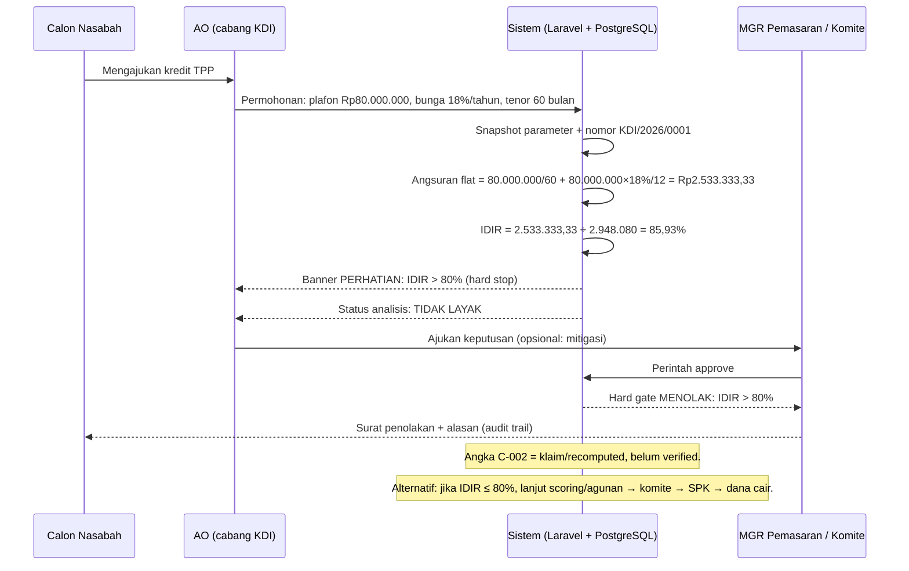

# Flow Proses Kredit BPR — End to End

Sistem yang dibangun adalah **sistem manajemen kredit lengkap**: dari calon nasabah mendaftar
sampai dana kredit masuk ke rekening, atau permohonan ditolak. Dokumen ini memetakan alurnya
dalam diagram + skenario contoh C-002 (TPP flat).

> Status angka: semua angka contoh berstatus **klaim/recomputed, belum verified** kecuali
> dinyatakan lain. Diagram ini menggambarkan desain, bukan klaim hasil audit.

---

## 1. Flowchart end-to-end

```mermaid
flowchart TD
  Start(["Calon nasabah datang ke cabang (KDI/BOM/KOL)"]) --> CIF

  subgraph F1["Fase 1 · Pendaftaran Nasabah (CIF)"]
    CIF["AO input data KYC (identitas, alamat, dokumen)"] --> Dup{"NIK duplikat lintas cabang?"}
    Dup -- "Ya" --> TolakDup["Tolak pendaftaran + alasan tercatat"] --> EndDup(["Arsip penolakan"])
    Dup -- "Tidak" --> NewCIF["Buat CIF nomor atomik: CIF-KDI-000001 + hash dokumen"]
  end

  NewCIF --> F2Start

  subgraph F2["Fase 2 · Permohonan Kredit"]
    F2Start["AO pilih produk/metode: TPP flat, produktif, grace, dsb."] --> Snap["Tangkap snapshot parameter kebijakan (grandfathering)"]
    Snap --> NoPerm["Nomor permohonan atomik: KDI/2026/0001"]
    NoPerm --> Dok{"Dokumen lengkap? consent SLIK? data agunan?"}
    Dok -- "Belum" --> Kembali["Kembalikan ke nasabah untuk dilengkapi"] --> Dok
    Dok -- "Lengkap" --> F3Start
  end

  subgraph F3["Fase 3 · Analisis (Workbench)"]
    F3Start["Input neraca & laba rugi"] --> Imb{"Selisih neraca > toleransi?"}
    Imb -- "Ya" --> Warn["Soft warning: banner + audit log (submit tidak diblokir)"] --> Ratios
    Imb -- "Tidak" --> Ratios
    Ratios["Hitung rasio & modal kerja: WCD, cash turnover"] --> Kap
    Kap["Kapasitas: RPC = surplus × margin; DSCR = RPC ÷ (angsuran baru + SLIK aktif dedupe)"] --> IDIR{"IDIR = angsuran baru ÷ penghasilan bersih"}
    IDIR -- "≤ 35%" --> Agunan
    IDIR -- "35% s.d. 80%" --> BannerIDIR["Banner PERHATIAN (batas 35% internal, bukan OJK)"] --> Agunan
    IDIR -- "> 80%" --> HardIDIR["HARD STOP — permohonan tidak layak"] --> Tolak1(["Ditolak + audit trail"])
    Agunan["Agunan: PPKA single-basis, LTV tanpa double-haircut"] --> LTV{"LTV > batas maksimum?"}
    LTV -- "Ya" --> TolakLTV["Tolak / mitigasi agunan"] --> Tolak1
    LTV -- "Tidak" --> Score["Scoring 5C (bobot total 1,00; override SLIK wajib alasan+otorisasi+audit)"]
    Score --> Stress["Sensitivitas: 6 skenario (delta dari policy)"]
  end

  Stress --> F4Start

  subgraph F4["Fase 4 · Rekomendasi"]
    F4Start["Rekomendasi plafon = MIN(pengajuan, plafon maksimum kapasitas, batas LTV)"] --> F5Start
  end

  subgraph F5["Fase 5 · Persetujuan Berjenjang"]
    F5Start["AO ajukan persetujuan"] --> Sod{"Pembuat ≠ penyetuju? cabang sama?"}
    Sod -- "Tidak" --> Forbid["403 — SoD / lintas cabang ditolak"] --> Tolak2(["Ditolak + audit"])
    Sod -- "Ya" --> Ladder["MGR Pemasaran → Komite sesuai limit"]
    Ladder --> Gate{"Hard gate approve: BR-01/02/03/05/11H/13 lulus?"}
    Gate -- "Tidak" --> Tolak3(["Tolak approve + alasan"])
    Gate -- "Ya" --> Approved["Persetujuan final"]
  end

  Approved --> F6Start

  subgraph F6["Fase 6 · Pencairan atau Penolakan"]
    F6Start["Terbitkan SPK: SPK/KDI/2026/0001"] --> NoKredit["Nomor kredit atomik: KDI/2026/K/0001"]
    NoKredit --> Memo["Memo cair: potong biaya, payoff top-up + penalti (TPP: blokir tabungan 2× angsuran)"]
    Memo --> Cair["Dana masuk rekening nasabah"]
  end

  Cair --> F7Start

  subgraph F7["Fase 7 · Pasca-Pencairan"]
    F7Start["Buku besar kredit + buku agunan (agunan_key lintas cabang)"] --> Monitor["Monitoring angsuran & kolektibilitas"]
    Monitor --> CKPN["CKPN/PPKA transisi; write-off parsial ditolak, full wajib eligible"]
  end

  Tolak1 -.-> |"surat penolakan + alasan"| EndTolak(["Permohonan ditolak — semua jejak diaudit"])
  Tolak2 -.-> EndTolak
  Tolak3 -.-> EndTolak
```

---

## 2. Sequence diagram — skenario C-002 (TPP flat)

---

## 3. Tabel keputusan per gate

| Gate | Kondisi | Keluaran |
|---|---|---|
| Pendaftaran CIF | NIK duplikat lintas cabang | Tolak pendaftaran + alasan |
| Permohonan | Dokumen/consent/agunan belum lengkap | Kembali ke nasabah |
| Neraca | Selisih > toleransi | Soft warning (banner + audit), tidak blokir submit |
| IDIR | ≤ 35% | Lanjut |
| IDIR | 35% – 80% | Banner PERHATIAN (batas internal) |
| IDIR | > 80% | Hard stop — tolak |
| LTV | > batas maksimum | Tolak / mitigasi agunan |
| Scoring 5C | Bobot ≠ 1,00 | Konfigurasi ditolak (validasi) |
| Override SLIK | Tanpa alasan/otorisasi/audit | Ditolak |
| Persetujuan | Pembuat = penyetuju, atau lintas cabang | 403 |
| Approve | Hard gate BR-01/02/03/05/11H/13 gagal | Tolak approve |
| Pencairan | SPK/booking belum lengkap | Tunda pencairan |
| Write-off | Parsial | Ditolak |
| Write-off | Full tapi tidak eligible | Ditolak |

---

## 4. Legenda singkatan

| Istilah | Arti |
|---|---|
| CIF | Catatan identitas nasabah (satu nomor per nasabah, lintas cabang) |
| KYC | Kenali nasabah: verifikasi identitas dan dokumen |
| SLIK | Informasi riwayat kredit dari OJK; dipakai untuk DSR/IDIR |
| IDIR | Installment to Disposable Income Ratio: angsuran baru ÷ penghasilan bersih |
| DSCR | Debt Service Coverage Ratio: RPC ÷ total kewajiban bulanan |
| RPC | Repayment Capacity: surplus × margin kapasitas |
| LTV | Loan to Value: kredit ÷ nilai agunan basis tunggal |
| PPKA | Penyisihan Penilaian Kualitas Aset (basis nilai agunan) |
| CKPN | Cadangan Kerugian Penurunan Nilai |
| BMPK | Batas Maksimum Pemberian Kredit (pihak terkait/borrower group) |
| SoD | Segregation of Duties: pembuat tidak boleh menyetujui miliknya sendiri |
| Hard stop | Aturan yang menolak transaksi |
| Soft warning | Peringatan yang tidak memblokir, tetapi tercatat |
| Snapshot | Salinan parameter kebijakan saat permohonan dibuat |
| Grandfathering | Permohonan lama tetap memakai snapshot lama |
| Ledger | Catatan peristiwa append-only dengan hash chain |

---

## 5. Pemetaan ke aturan & kasus golden

| Fase | Aturan terkait | Kasus golden terkait |
|---|---|---|
| Analisis kapasitas | BR-01/02/03/10/11/11H/12/13 | G-TPP-01, G-CAP-01..05, G-MK-01..03 |
| Jadwal/EIR | — | G-SCH-01..08 |
| Agunan/scoring | — | G-COL-01/02, G-SCR-01/02 |
| Keputusan/stres | BR-05 | G-DEC-01/02, G-STR-01/02 |
| Negatif/operasional | — | G-RAC-01/02, G-CKP-01, G-WO-01 |
| Submit/approve | BR-04/05/08/14/15 (submit); BR-01/02/03/05/11H/13 (approve) | — |
| Penomoran/backfill | NomorService atomik | B4-01..05 |
| Pencairan TPP | — | G-TPP-04/05 |
