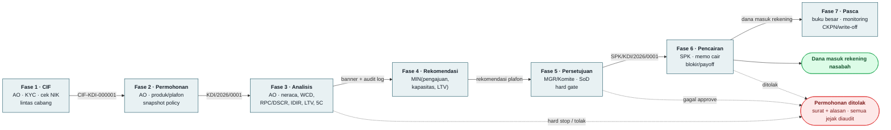
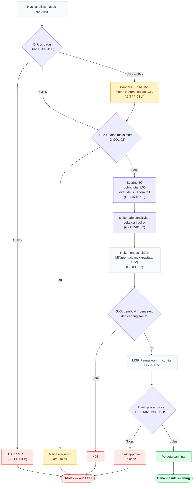
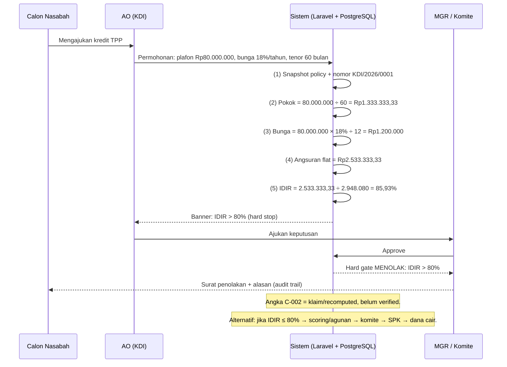

# Flow Proses Kredit BPR — End to End

Sistem yang dibangun adalah **sistem manajemen kredit lengkap**: dari calon nasabah mendaftar
sampai dana kredit masuk ke rekening, atau permohonan ditolak. Dokumen ini memetakan alurnya
dalam tiga lapis diagram + skenario contoh C-002 (TPP flat).

> Status angka: semua angka contoh berstatus **klaim/recomputed, belum verified** kecuali
> dinyatakan lain. Diagram menggambarkan desain, bukan klaim hasil audit.

---

## 1. Pipeline 7 fase (overview)

Satu baris proses; setiap tepi membawa artefak kunci yang dihasilkan fase sebelumnya.

## Ringkasan tiap fase

| Fase | Job utama | Artefak kunci |
|---|---|---|
| 1 · CIF | Verifikasi identitas, cegah nasabah ganda | `CIF-KDI-000001`, hash dokumen |
| 2 · Permohonan | Kunci produk, plafon, dan parameter kebijakan | `KDI/2026/0001`, snapshot policy |
| 3 · Analisis | Hitung kapasitas, agunan, scoring, sensitivitas | Banner warning, audit log, status IDIR/DSCR/LTV |
| 4 · Rekomendasi | Batasi plafon agar tidak melebihi kapasitas/agunan | Rekomendasi MIN(...) |
| 5 · Persetujuan | Persetujuan berjenjang dengan pemisahan tugas | Keputusan approve + hard gate |
| 6 · Pencairan | Booking kredit dan kirim dana | `SPK/KDI/2026/0001`, `KDI/2026/K/0001`, memo cair |
| 7 · Pasca | Catat posisi, pantau, kelola risiko | Buku besar, buku agunan, CKPN |

---

## 2. Gerbang keputusan detail (Analisis + Persetujuan)

Diagram ini memperbesar bagian yang menentukan: aturan mana yang lolos, warning, atau menolak.

Kode warna: **hijau** = lanjut/cair, **kuning** = peringatan/mitigasi, **merah** = hard stop/tolak.

---

## 3. Sequence — skenario C-002 (TPP flat)

Skenario konkret: angka dihitung langkah demi langkah, lalu sistem menolak di hard gate.

---

## 4. Tabel keputusan per gate

| Gate | Kondisi | Keluaran | Status |
|---|---|---|---|
| Pendaftaran CIF | NIK duplikat lintas cabang | Tolak pendaftaran + alasan | Tolak |
| Permohonan | Dokumen/consent/agunan belum lengkap | Kembali ke nasabah | Tunda |
| Neraca | Selisih > toleransi | Soft warning (banner + audit), tidak blokir submit | Warning |
| IDIR | ≤ 35% | Lanjut | Lolos |
| IDIR | 35% – 80% | Banner PERHATIAN (batas internal) | Warning |
| IDIR | > 80% | Hard stop — tolak | Tolak |
| LTV | > batas maksimum | Tolak / mitigasi agunan | Tolak |
| Scoring 5C | Bobot ≠ 1,00 | Validasi konfigurasi gagal | Tolak |
| Override SLIK | Tanpa alasan/otorisasi/audit | Ditolak | Tolak |
| Persetujuan | Pembuat = penyetuju, atau lintas cabang | 403 | Tolak |
| Approve | Hard gate BR-01/02/03/05/11H/13 gagal | Tolak approve | Tolak |
| Pencairan | SPK/booking belum lengkap | Tunda pencairan | Tunda |
| Write-off | Parsial | Ditolak | Tolak |
| Write-off | Full tapi tidak eligible | Ditolak | Tolak |

---

## 5. Legenda singkatan

| Istilah | Arti |
|---|---|
| CIF | Catatan identitas nasabah (satu nomor per nasabah, lintas cabang) |
| KYC | Kenali nasabah: verifikasi identitas dan dokumen |
| SLIK | Informasi riwayat kredit dari OJK; dipakai untuk DSR/IDIR |
| IDIR | Installment to Disposable Income Ratio: angsuran baru ÷ penghasilan bersih |
| DSCR | Debt Service Coverage Ratio: RPC ÷ total kewajiban bulanan |
| RPC | Repayment Capacity: surplus × margin kapasitas |
| LTV | Loan to Value: kredit ÷ nilai agunan basis tunggal |
| PPKA | Penyisihan Penilaian Kualitas Aset (basis nilai agunan) |
| CKPN | Cadangan Kerugian Penurunan Nilai |
| BMPK | Batas Maksimum Pemberian Kredit (pihak terkait/borrower group) |
| SoD | Segregation of Duties: pembuat tidak boleh menyetujui miliknya sendiri |
| Hard stop | Aturan yang menolak transaksi |
| Soft warning | Peringatan yang tidak memblokir, tetapi tercatat |
| Snapshot | Salinan parameter kebijakan saat permohonan dibuat |
| Grandfathering | Permohonan lama tetap memakai snapshot lama |
| Ledger | Catatan peristiwa append-only dengan hash chain |

---

## 6. Pemetaan ke aturan & kasus golden

| Fase | Aturan terkait | Kasus golden terkait |
|---|---|---|
| Analisis kapasitas | BR-01/02/03/10/11/11H/12/13 | G-TPP-01, G-CAP-01..05, G-MK-01..03 |
| Jadwal/EIR | — | G-SCH-01..08 |
| Agunan/scoring | — | G-COL-01/02, G-SCR-01/02 |
| Keputusan/stres | BR-05 | G-DEC-01/02, G-STR-01/02 |
| Negatif/operasional | — | G-RAC-01/02, G-CKP-01, G-WO-01 |
| Submit/approve | BR-04/05/08/14/15 (submit); BR-01/02/03/05/11H/13 (approve) | — |
| Penomoran/backfill | NomorService atomik | B4-01..05 |
| Pencairan TPP | — | G-TPP-04/05 |
